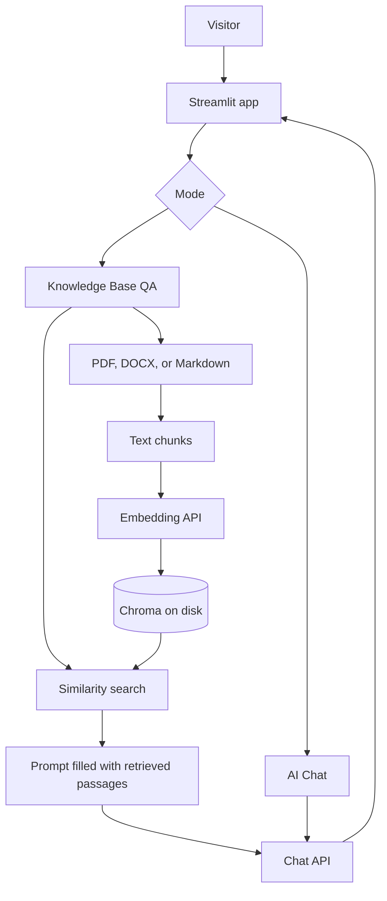
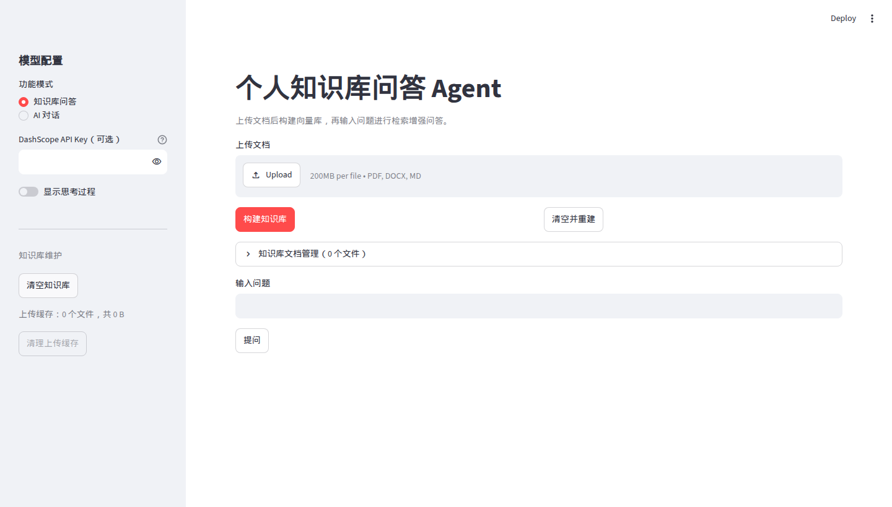
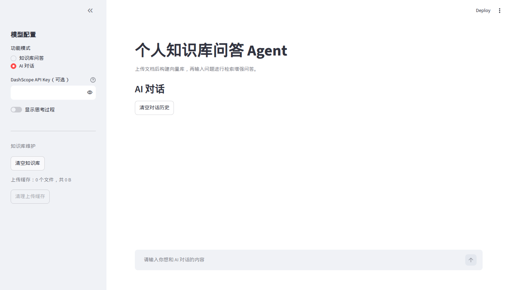

# Personal Knowledge Base QA Agent

[](https://www.python.org/)
[](LICENSE)
[](https://github.com/hjlangcore/Personal-Knowledge-Base-QA-Agent/actions/workflows/ci.yml)
[](https://github.com/hjlangcore/Personal-Knowledge-Base-QA-Agent/stargazers)

Ask questions over your own documents.

Upload a PDF, Word file, or Markdown note. The app splits the text, stores embeddings in a local [Chroma](https://www.trychroma.com/) index, and answers from the passages it retrieves. A second mode is ordinary multi-turn chat for when the question is not about those files.

This is a small, readable example of a site chatbot backed by private documents: one Streamlit UI, an OpenAI-compatible API (Qwen on DashScope by default), and answers that can show the source snippet and page.

[简体中文](README_ZH.md)

The interface text is Chinese. The screenshots below are the running app.

## Features

- Upload `PDF`, `DOCX`, and `MD` files
- Chunk text with `RecursiveCharacterTextSplitter` (Chinese punctuation included)
- Persistent local vector index with Chroma
- Chat through any OpenAI-compatible endpoint; defaults to DashScope Qwen
- Streaming answers, with an optional view of the model's reasoning trace
- Two modes: Knowledge Base QA and AI Chat
- Index maintenance: clear, rebuild, clear-and-rebuild, list files, delete one file, clear the upload cache
- Multi-turn chat history with a clear-history action
- Source snippets with file name and page number when the loader provides one
- Session API key in the sidebar, kept in that browser session only

## Stack

- Python 3.10+
- Streamlit
- LangChain and langchain-chroma
- ChromaDB
- OpenAI Python SDK, pointed at an OpenAI-compatible base URL

## Architecture



Knowledge Base QA retrieves the top matching chunks, then asks the model to answer from that text. If retrieval returns nothing, the app replies `未找到相关内容` and skips the model call. AI Chat sends the conversation to the same chat API and leaves the index alone.

Rebuilding a file deletes that file's previous chunks first. A different file is added to the same index.

## Quick start

```bash
python -m venv .venv
source .venv/bin/activate
pip install -r requirements.txt
export DASHSCOPE_API_KEY="your-dashscope-key"
streamlit run app.py
```

PowerShell:

```powershell
python -m venv .venv
.\.venv\Scripts\Activate.ps1
pip install -r requirements.txt
$env:DASHSCOPE_API_KEY="your-dashscope-key"
streamlit run app.py
```

Open the URL Streamlit prints (usually `http://localhost:8501`).

The app reads process environment variables. It does not load a `.env` file. See [`.env.example`](.env.example) for the variable names. With `streamlit run`, root-level keys in `.streamlit/secrets.toml` are also exposed as environment variables. That file is gitignored.

`OPENAI_API_KEY` is accepted when `DASHSCOPE_API_KEY` is unset. A key typed into the sidebar is used for that browser session and is not written back to the environment.

## Environment variables

| Variable | Required | Default | Purpose |
| --- | --- | --- | --- |
| `DASHSCOPE_API_KEY` | One of the two keys | empty | Preferred API key |
| `OPENAI_API_KEY` | One of the two keys | empty | Fallback API key |
| `OPENAI_BASE_URL` | no | `https://dashscope.aliyuncs.com/compatible-mode/v1` | OpenAI-compatible base URL |
| `CHAT_MODEL` | no | `qwen3.6-plus` | Chat model name |
| `EMBEDDING_MODEL` | no | `text-embedding-v4` | Embedding model name |
| `VECTOR_DB_DIR` | no | `data/chroma_db` | Chroma directory |
| `EMBEDDING_BATCH_SIZE` | no | `10` | Texts per embedding request. DashScope `text-embedding-v4` allows at most 10 |
| `ENABLE_THINKING` | no | `true` | Send `enable_thinking` when the model supports it. Set `false` otherwise |
| `CHUNK_SIZE` | no | `500` | Chunk size in characters |
| `CHUNK_OVERLAP` | no | `100` | Overlap between chunks |
| `RETRIEVAL_K` | no | `4` | How many chunks to retrieve |

## Screenshots

Captured from the local app. A placeholder key was set in the environment so the form could render. No document was indexed, and no model was called.



Knowledge Base QA: upload a file, build the index, then ask a question. The sidebar also clears the index and the upload cache.



AI Chat: multi-turn conversation with the chat model.

## Free public demo

Streamlit Community Cloud can host this app as a public demo at no charge for a public GitHub repository. Nothing in this repo is deployed for you; use the steps when you want a live link.

1. Sign in at [share.streamlit.io](https://share.streamlit.io) with GitHub.
2. Choose **Create app**, then **Yup, I have an app**.
3. Select repository `hjlangcore/Personal-Knowledge-Base-QA-Agent`, branch `main`, and main file path `app.py`.
4. Open **Advanced settings**. Community Cloud defaults to Python 3.12, which matches the version used in CI. In **Secrets**, paste a root-level key. Root-level secrets are exposed as environment variables, which is what the app reads:

   ```toml
   DASHSCOPE_API_KEY = "your-dashscope-key"
   ```

5. Deploy. The app is served on a `streamlit.app` URL.

Docs: [Deploy your app on Community Cloud](https://docs.streamlit.io/deploy/streamlit-community-cloud/deploy-your-app/deploy) and [secrets management](https://docs.streamlit.io/develop/concepts/connections/secrets-management).

Visitors who build an index or ask a question spend that key's quota. Use a key you can revoke, and keep it in Community Cloud secrets.

## Usage

1. Optional: paste a DashScope key in the sidebar. It applies to the current browser session only.
2. Choose **知识库问答** (Knowledge Base QA) or **AI 对话** (AI Chat).
3. In Knowledge Base QA, upload a document and choose **构建知识库**, then enter a question and choose **提问**. Rebuilding the same file replaces its chunks. A different file is added to the same index.
4. In AI Chat, type in the message box. **清空对话历史** clears that session's history.
5. **显示思考过程** shows the model's reasoning trace when the API returns one. It is off by default.
6. **清空知识库** removes every vector. **清空并重建** clears the index, then indexes the file currently selected in the uploader.
7. **知识库文档管理** lists indexed files and chunk counts, and can delete one file from the index.
8. **清理上传缓存** deletes raw files under `data/uploads`. The vector index stays as it is.

## Project structure

```text
.
├── app.py                     # Streamlit entry
├── requirements.txt
├── requirements-dev.txt       # App deps plus pytest
├── .env.example               # Variable names only, no secrets
├── docs/images/               # Screenshots of the local UI
├── tests/                     # Pytest suite, model calls mocked
├── .github/workflows/ci.yml
└── src
    ├── config.py              # Environment variables
    ├── document_processor.py  # Load and split
    ├── vector_store.py        # Embeddings and Chroma
    └── qa_chain.py            # Retrieval QA and chat streaming
```

`data/chroma_db/` and `data/uploads/` are local runtime data and are gitignored.

## Tests

```bash
pip install -r requirements-dev.txt
pytest
```

The suite covers settings parsing, Markdown loading and chunking, prompt assembly, streaming with a fake client, embedding batch order, and Chroma replace/delete/clear on a temporary directory. It does not call DashScope or any other paid API.

[`.github/workflows/ci.yml`](.github/workflows/ci.yml) runs that suite on Python 3.12 for pushes to `main` and for pull requests.

## Troubleshooting

- **401 Unauthorized.** Check `DASHSCOPE_API_KEY` or `OPENAI_API_KEY`.
- **Vector retrieval error on a question.** Use **清空并重建**, then ask again.
- **Answer quality moves around.** Tune `CHUNK_SIZE`, `CHUNK_OVERLAP`, and `RETRIEVAL_K`.
- **AI Chat ignores an uploaded file.** Uploaded files are consulted in Knowledge Base QA. AI Chat sends the conversation to the model only.
- **Empty or scanned PDF.** The builder stops when parsing produces no text. The loaders read embedded text; they do not OCR a scan.

## Security

Keep keys in the environment or in Streamlit secrets. Do not commit `.env`, `.streamlit/secrets.toml`, or a key in source. If a key is exposed, revoke it on the provider and create a new one.

## Roadmap

- Retrieval reranking
- Export of Q&A history
- More specific error messages for provider failures

## License

[MIT](LICENSE)
